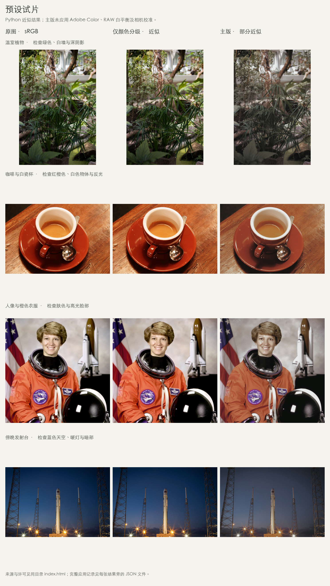

# LrC_XMP

可重复使用的 Lightroom XMP 调色预设，附参数来源、核对记录和摄影师风格研究。

当前收录 **2 个预设**：一个按视频最终参数制作的主版，一个仅含颜色分级的早期简版。两份 XMP 均已通过文件检查，**尚未导入 Lightroom，也未验证预设面板显示或照片效果**。

现在可以先看 [Python 试片](docs/Python预览.md)：已选取四张有明确使用许可的照片，生成两份预设共 **8 张近似结果**。打开 [离线对照页](examples/python-preview/index.html) 可切换预设并拖动比较；GitHub 上可直接查看下方总览图。

主版预览应用了 32 项标量调整和 4 条曲线，明确跳过 8 项 RAW／Adobe 专属设置。XMP 原值没有修改，Python 结果不等同于 Lightroom 渲染。

## 下载预设

| 文件 | 内容与适用范围 | 状态 |
| --- | --- | --- |
| [品川力仿色｜原视频确认值（ProRAW）](presets/confirmed/品川力仿色_原视频确认值_ProRAW.xmp) | 原案例的基础调整、曲线、HSL、颜色分级和校准；面向 RAW／ProRAW | 主版；41 项标量设置、4 条曲线、18 个锚点已核对 |
| [平川参考｜仅已知颜色分级](presets/partial/平川参考_仅已知颜色分级.xmp) | 仅含最初笔记中的 8 项颜色分级值 | 早期简版；保留原文件名，不代表完整风格 |

打开文件页后选择 **Download raw file**，即可下载 `.xmp`。也可从仓库的 **Code → Download ZIP** 下载全部文件。

主版的 [参数来源](presets/confirmed/品川力仿色_原视频确认值_ProRAW.source.json) 和 [文件核对记录](presets/confirmed/品川力仿色_原视频确认值_ProRAW.verification.json) 一并保留。两份 XMP 的哈希见 [SHA256SUMS](SHA256SUMS)。

## 主版来自哪里

参数来自 LeoCarbin摄影发布的 [《百万人想学的色调｜学会就是大师 品川力仿色》](https://www.douyin.com/video/7635868630110035057)。这是该教程的参数复现，不能称为品川力本人发布的预设。

视频案例使用 iPhone 的 `IMG_2626.DNG`，配置文件从 Apple ProRaw 改为 **Adobe Color**。Adobe Color 是配置文件；笔记中的 Adobe RGB 指向另一种色彩空间概念。主版按视频中的 Adobe Color 保存。

为保留案例最终值，主版包含固定的曝光 **+0.30**、色温 **5903 K**、色调 **+9**。基础面板最后的高光、阴影、白色色阶分别为 **−68、+24、−77**，早先画面出现的数值是中间步骤。主版没有自动适配曝光或白平衡的功能。

未指定的调整没有补零或写入默认值，包括锐化、降噪、裁剪、镜头校正和颗粒等。目标照片已有设置仍可能影响结果。普通 iPhone JPEG／HEIC 与本案例的 RAW 处理路径不同，其兼容性和效果尚未验证。

## 安装与验证状态

制作环境没有可用的 Lightroom 或 Lightroom MCP，Adobe 安装已取消。当前交付是可下载的 XMP 文件，尚未安装进 Lightroom 预设目录。

以后在具备授权的 Lightroom 中导入主版时，预期名称为「品川力仿色｜原视频确认值（ProRAW）」，分组为「视频调色复现」。需要在测试副本上确认面板可见、应用结果和参数读回，才能把状态改成已实测。

| 检查 | 结果 |
| --- | --- |
| XML／RDF 结构及文件参数读回 | 通过 |
| 主版参数与逐帧记录对照 | 41 项标量、4 条曲线、18 个锚点一致 |
| 最初提供的颜色分级数值 | 两版的 8 项均保留 |
| 预设 UUID | 两版不同 |
| Lightroom 导入、面板可见、照片应用及参数读回 | 未验证 |

## 后续仿色

[摄影师风格调研](docs/摄影师风格调研.md) 收录了川内伦子、Saul Leiter、Alex Webb、Ernst Haas、William Eggleston 和 Todd Hido。文档给出了作品入口、可尝试的调色方向和所需拍摄条件。

后续建议先做「柔光日常」「雨窗街景」「烈日浓色」三个场景，分别参考川内伦子、Saul Leiter 和 Alex Webb。它们目前属于研究候选，仓库中尚无对应 XMP。

新增文件遵循 [预设制作约定](docs/预设制作约定.md)。公开资料中的原始数值与我们自行试验的仿色参数分别记录，便于以后修订和复用。

仓库保存预设、预览工具、自写说明、有许可的对照图片及来源链接。作品及教程的权利归原作者所有；本仓库未获这些摄影师背书。
