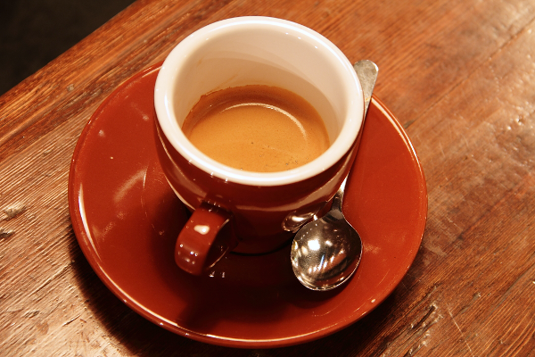
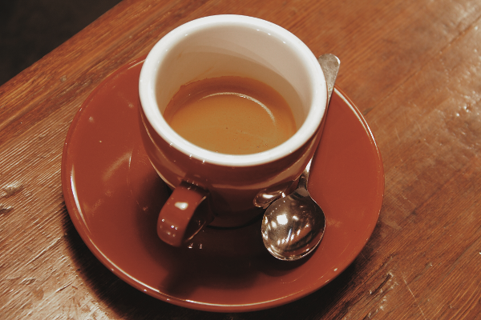
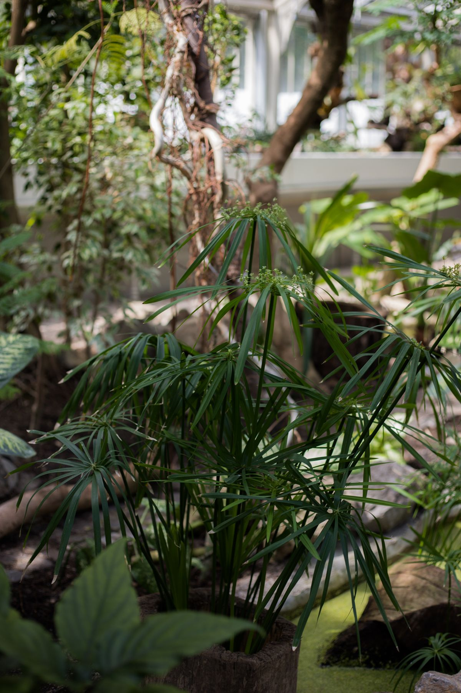
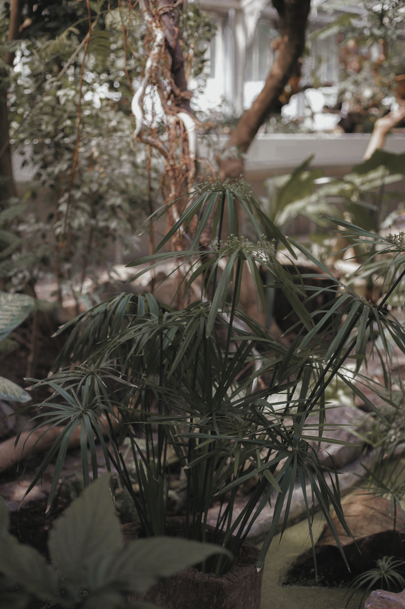
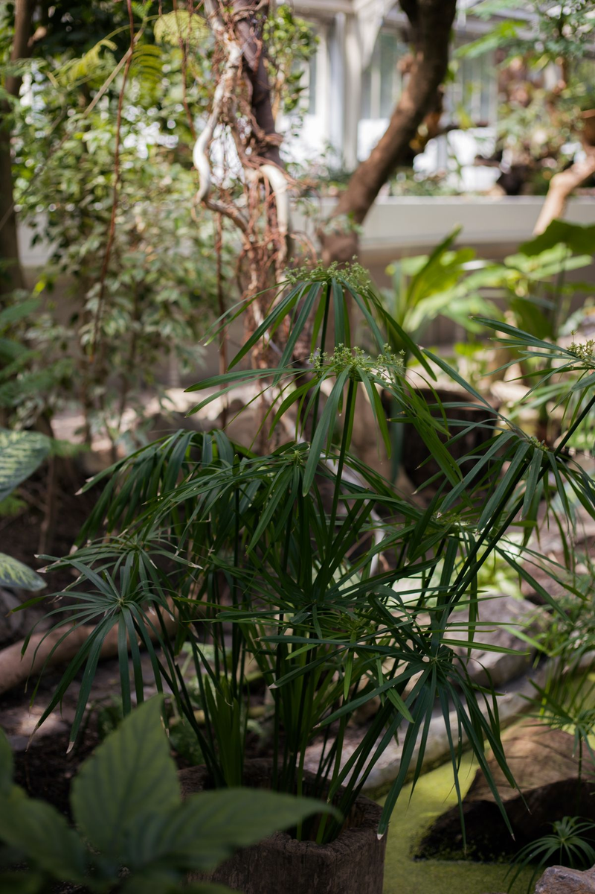
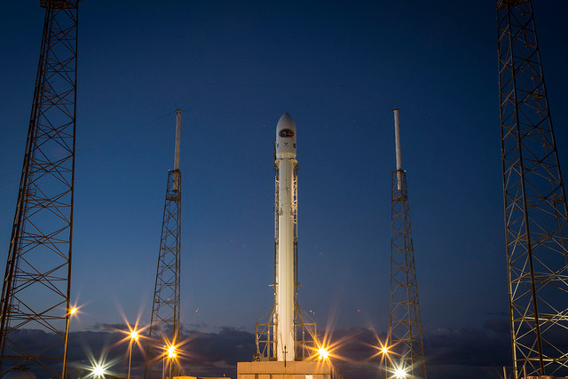
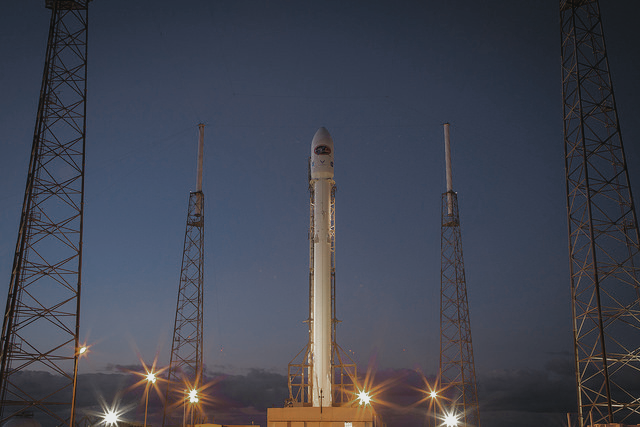
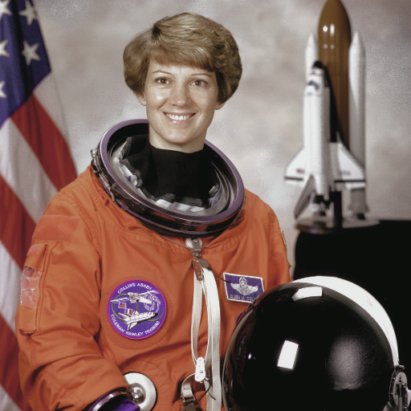

<div align="center">

# 🎞️ LrC_XMP

### 选张照片，一键找到喜欢的色调。

把喜欢的调色配方存下来，下次拍照还能接着用。<br>
启动本地页面，选一张照片，点一次按钮，就能并排比较全部预设。

**本地免费试色 · 无需 Adobe 账号 · 原片保留**

[交给 Agent](#一句话交给-agent) · [看全部效果](#先看效果) · [试自己的照片](#一键试自己的照片) · [下载 XMP](#把喜欢的配方带走)

</div>

## 一句话交给 Agent

把下面这段话交给能操作本地终端和文件的 Agent，它会按 [AGENTS.md](AGENTS.md) 准备环境、试遍预设，并交付可查看的结果：

```text
请帮我使用 https://github.com/AnnaXChun/LrC_XMP，先读取根目录的 AGENTS.md，按说明完成环境准备、全部预设试色、结果核对和文件交付。有我提供的照片就用我的照片，否则先跑样张。保留原图和预设参数，最后给我前后对照、调色图片、可复用的 XMP、处理报告和下载包。请直接执行，不要只给操作教程。
```

有自己的照片时，一并提供附件或本地路径。没有照片也能先看样张。仓库已公开，无需 GitHub 登录即可读取或下载。首次使用需要联网准备依赖，也可以使用已下载的仓库副本。

前置要求、配置、失败处理和交付清单都在 [Agent 使用说明](AGENTS.md) 中。拿到文件后，可以直接看对照，再决定保留哪种色调。

先看现成效果？[下载样张与预设包](https://github.com/AnnaXChun/LrC_XMP/releases/tag/demo-2026-10-22)，完整解压后打开 `index.html`，即可离线比较。包内附全部调色图片、XMP、处理报告和校验清单。

## 先看效果

喜欢低饱和、柔和亮部的照片？先从这组品川力仿色试起。温室里的绿色收敛了，白瓷杯的反光柔和了，傍晚的蓝色也淡了下来。

**当前全部 2 份预设，已用于 4 张样片，共 8 张结果。** 主版的变化更明显，仅颜色分级版适合先比较轻一些的变化。

> 以下是 Python 近似试色。主版尚未应用 Adobe Color、RAW 白平衡和相机校准，与 Lightroom 的实际效果可能不同。[查看处理范围](docs/Python预览.md#参数到底应用了多少)

| 原图 | 品川力仿色 · 主版 | 仅颜色分级 · 简版 |
| :---: | :---: | :---: |
|  |  |  |
|  |  |  |
|  |  |  |
|  |  |  |

想放大看细节？[打开对照总图](examples/python-preview/contact-sheet.png)，或下载仓库后打开 [离线对照页](examples/python-preview/index.html)，切换预设、拖动分界线。GitHub 文件页展示的是 HTML 源码，下载后才能操作。

主版会让肤色和橙色衣服一起变灰。喜欢浓郁色彩或希望保留肤色时，建议先对比简版。预设适不适合，放到自己的照片上看最直接。

## 一键试自己的照片

本地试色页面已经支持选照片、应用全部预设、并排查看，以及单张或打包下载。也可以直接选内置样张试用。

首次使用，先[下载仓库 ZIP](https://github.com/AnnaXChun/LrC_XMP/archive/refs/heads/main.zip) 并解压，安装 [uv](https://docs.astral.sh/uv/getting-started/installation/)。在解压后的文件夹中打开终端，运行：

```bash
uv run --locked --extra ui streamlit run app.py
```

首次启动会下载所需依赖；缺少合适版本的 Python 时，uv 会一并下载。后续沿用本地环境。浏览器打开后：

1. 放入照片，或选一张内置样张。
2. 点击 **「一键试遍全部 2 个预设」**。
3. 并排看效果，下载喜欢的版本，或点击 **「打包下载全部结果」**。

页面地址是 `http://127.0.0.1:8501`。照片在本机处理；程序只读取照片副本，结果另行下载。新增预设后，页面会自动纳入，按钮上的数量也会更新。

支持 JPG、PNG、TIFF、WebP 的不透明 RGB／灰度照片，单张最多 25 MB。输出为 PNG，长边最多 1200 像素，适合比较色调。手机 HEIC、RAW／DNG 请先导出为 JPG 再试。

<details>
<summary>想重新跑一遍全部样片？</summary>

在仓库目录运行下面这条命令，就会把全部 XMP 用于四张样片，生成对照网页、图片和报告：

```bash
uv run --locked python -m lrc_xmp.demo
```

结果保存在新的 `local/preview-日期时间/` 目录中。打开其中的 `index.html` 即可比较。总览图需要系统中有中文字体，详见 [Python 预览说明](docs/Python预览.md#重复运行)。

</details>

## 把喜欢的配方带走

XMP 保存了原始参数，可以留作以后在 Lightroom 中复用。打开下方文件页，点击 **Download raw file** 下载。

| 预设 | 里面有什么 |
| --- | --- |
| [品川力仿色 · 主版](presets/confirmed/品川力仿色_原视频确认值_ProRAW.xmp) | 按原视频最终数值整理，含基础调整、曲线、HSL、颜色分级和校准，面向 RAW／ProRAW |
| [仅颜色分级 · 简版](presets/partial/平川参考_仅已知颜色分级.xmp) | 保留早期笔记中的 8 项颜色分级参数；文件名沿用「平川参考」 |

主版来自 **LeoCarbin摄影**的[品川力仿色教程](https://www.douyin.com/video/7635868630110035057)，属于教程参数复现。每份预设都附来源和核对记录，原值没有因这些样片而改动。

主版保留了案例的固定曝光 **+0.30**、色温 **5903 K**、色调 **+9**，复用时需要结合照片判断。当前已完成 XMP 文件核对，Lightroom 导入、预设面板显示、应用和参数读回尚未实测。完整记录见 [预设来源与验证](docs/预设来源与验证.md)。

## 下一种色调，一起找

接下来想尝试柔光日常、雨窗街景和烈日浓色。[摄影师风格调研](docs/摄影师风格调研.md) 已整理川内伦子、Saul Leiter、Alex Webb 等 6 位摄影师的作品入口；这些方向目前是研究候选，还没有对应预设。

欢迎在 [Issues](https://github.com/AnnaXChun/LrC_XMP/issues) 留下喜欢的作品或教程链接，说明想用在哪类照片上。后续仿色会继续附上原图与结果，让每一种风格都有样片可看。

<details>
<summary>参数、实现与图片来源</summary>

- [预设来源与验证](docs/预设来源与验证.md)：参数依据、固定设置、Lightroom 验证状态。
- [Python 预览说明](docs/Python预览.md)：近似模型、跳过字段、开源库选择和运行方法。
- [预设制作约定](docs/预设制作约定.md)：如何保留原值、记录来源和新增风格。
- [照片与许可](examples/sources.json)：Jovan Vasiljević／Pexels、Rachel Michetti／CC0、NASA 和 SpaceX／来源文档标注公有领域。
- [SHA256SUMS](SHA256SUMS)：两份 XMP 的文件哈希。

摄影作品、教程和样片遵循各自来源的权利与许可。本项目为独立整理与研究，未获相关摄影师背书。

</details>
