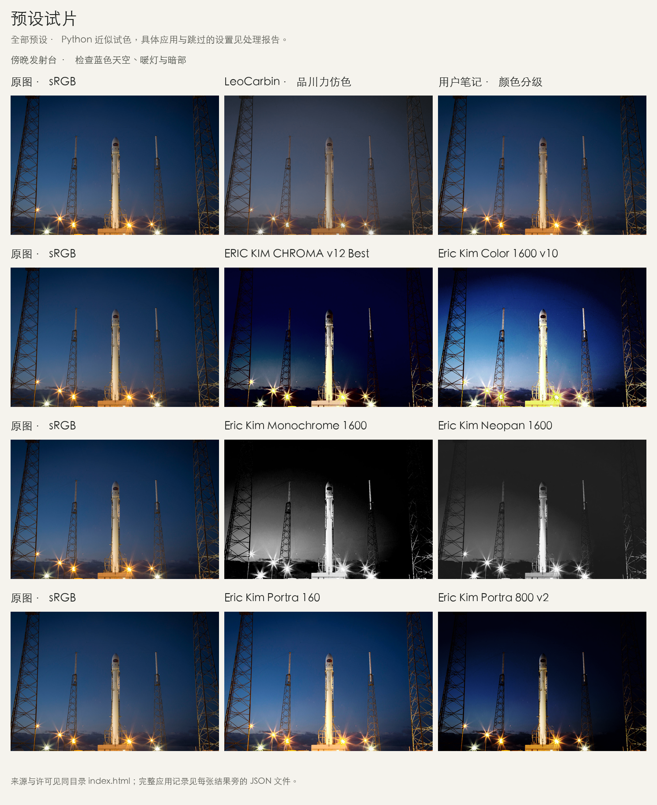
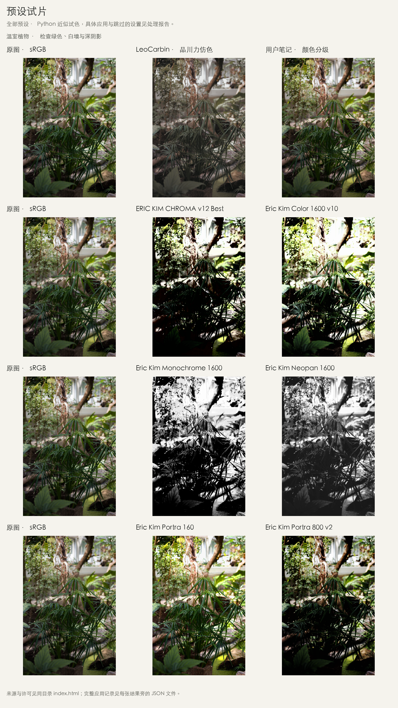
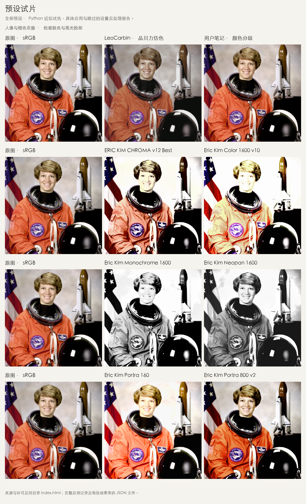

<div align="center">

# 🎞️ LrC_XMP

### 摄影师公开预设，原文件下载，一键试色。

选张照片，比较不同版本，再把喜欢的预设与结果一起带走。<br>
当前收录 **Eric Kim 本人发布的 6 份原生 XMP**，另保留 2 份教程／笔记参考。

**原文件与参数保留 · 本地免费试色 · 无需 Adobe 账号**

[交给 Agent](#一句话交给-agent) · [看对照](#先看效果) · [下载 XMP](#摄影师本人发布的预设) · [完整下载包](https://github.com/AnnaXChun/LrC_XMP/releases/tag/authors-2026-10-22)

</div>

## 摄影师本人发布的预设

本次使用街头摄影师 **Eric Kim** 在[本人网站](https://erickimphotography.com/blog/product/eric-kim-lightroom-presets/)发布的预设，从页面列出的 Dropbox 镜像下载。下面 6 份 XMP 与作者压缩包内文件逐字节一致，名称、UUID、参数和曲线均未修改。

| 原文件 | 内容与使用提示 |
| --- | --- |
| [Eric Kim Color 1600 v10](presets/photographers/eric-kim/Eric%20Kim%20Color%201600%20v10.xmp) | 作者在[预设说明页](https://erickimphotography.com/blog/presets/)推荐用于彩色 JPEG 的版本；包含固定曝光 +1.59 |
| [ERIC KIM CHROMA v12 Best](presets/photographers/eric-kim/ERIC%20KIM%20CHROMA%20v12%20Best.xmp) | 作者包中的彩色版本，固定曝光 +0.39、对比度 +100 |
| [Eric Kim Portra 160](presets/photographers/eric-kim/Eric%20Kim%20Portra%20160.xmp) | 作者命名的胶片模拟版本，固定曝光 +0.85 |
| [Eric Kim Portra 800 v2](presets/photographers/eric-kim/Eric%20Kim%20Portra%20800%20v2.xmp) | 另一款彩色版本，固定曝光 −0.20 |
| [Eric Kim Monochrome 1600](presets/photographers/eric-kim/Eric%20Kim%20Monochrome%201600.xmp) | 作者常用的高对比黑白版本，针对 Ricoh GR II RAW 优化 |
| [Eric Kim Neopan 1600](presets/photographers/eric-kim/Eric%20Kim%20Neopan%201600.xmp) | 作者包中的另一款黑白胶片模拟版本 |

每份文件附来源、原包路径、SHA-256 与核对记录。[查看来源和授权依据](docs/摄影师原版预设.md)。这些是 **同一位摄影师发布的 6 个版本**，不代表 6 位摄影师，也不是胶片厂商发布的官方模拟。

原有[品川力仿色主版](presets/confirmed/品川力仿色_原视频确认值_ProRAW.xmp)来自 **LeoCarbin摄影的仿色教程**，并非品川力本人发布；[颜色分级简版](presets/partial/平川参考_仅已知颜色分级.xmp)来自用户笔记。两份保持原样，作为历史参考一同试色。

此前项目自制的柔光日常、雨窗暖色、烈日浓色、冷夜暖灯已[移入归档](archive/self-authored-studies/)，退出默认列表和本次下载包。它们不是对应摄影师本人预设，旧发布只供追溯。

## 一句话交给 Agent

把下面这段话交给能操作本地终端和文件的 Agent，它会按 [AGENTS.md](AGENTS.md) 准备环境、试遍当前预设，并交付可查看的结果：

```text
请帮我使用 https://github.com/AnnaXChun/LrC_XMP，先读取根目录的 AGENTS.md，按说明完成环境准备、全部预设试色、结果核对和文件交付。有我提供的照片就用我的照片，否则先跑样张。保留原图和预设参数，最后给我前后对照、调色图片、可复用的 XMP、处理报告和下载包。请直接执行，不要只给操作教程。
```

有自己的照片时，一并提供附件或本地路径。没有照片也能先跑样张。仓库公开，无需 GitHub 登录。前置要求、配置和交付清单都在 [Agent 使用说明](AGENTS.md)。

先看现成结果？[下载完整试色包](https://github.com/AnnaXChun/LrC_XMP/releases/tag/authors-2026-10-22)，完整解压后打开 `index.html`，即可离线切换预设、拖动比较。包内附调色图片、全部 8 份 XMP、逐图报告和校验清单。

## 先看效果

**当前全部 8 份预设用于同一批 4 张样片，共 32 张结果。** 其中 Eric Kim 原件贡献 24 张，历史参考贡献 8 张。每行左边都是同一张原图，右边是两个版本。

> 图片采用 Python 独立近似模型。作者原件中的固定曝光照常参与计算；相机配置文件、RAW 白平衡、颗粒等未实现项会跳过。部分 JPEG 结果出现明显高光裁切，不能据此评价原预设在 Lightroom 中的真实效果。[查看处理范围](docs/Python预览.md)



<details>
<summary>展开温室、咖啡和人像的全部对照</summary>






</details>

这批近似输出里，Portra 800 v2 的彩色结果相对较暗，Neopan 1600 的黑白暗部较柔；Color 1600 v10 在白瓷杯和人像高光处明显过亮。完整保留这些结果，便于判断输入照片与原配方是否适合。预设参数没有为样张调整。

想放大比较，可以看[对照总图](examples/python-preview/contact-sheet.png)，或下载完整文件后打开[离线对照页](examples/python-preview/index.html)。GitHub 文件页展示 HTML 源码，交互需下载后使用。

## 一键试自己的照片

首次使用，先[下载仓库 ZIP](https://github.com/AnnaXChun/LrC_XMP/archive/refs/heads/main.zip) 并解压，安装 [uv](https://docs.astral.sh/uv/getting-started/installation/)。在仓库目录运行：

```bash
uv run --locked --extra ui streamlit run app.py
```

首次启动会准备 Python 和所需依赖，后续沿用本地环境。打开页面后：

1. 放入照片，或选一张内置样张。
2. 点击 **「一键试遍全部 8 个预设」**。
3. 并排比较，下载单张，或打包带走全部结果。

默认地址为 `http://127.0.0.1:8501`。照片在本机处理，程序读取副本，保留原图。

支持不透明 RGB／灰度 JPG、PNG、TIFF、WebP，单张最多 25 MB。输出 PNG 长边最多 1200 像素。手机 HEIC、RAW／DNG 请先导出为 JPG；原生 XMP 可以留待有授权的 Lightroom 环境直接使用。

重新跑全部样片：

```bash
uv run --locked python -m lrc_xmp.demo
```

结果保存到新的 `local/preview-日期时间/`，含图片、离线网页和报告。总览图需要中文字体，详见 [Python 预览说明](docs/Python预览.md#重复运行)。

## 来源与验证

- [摄影师原版预设](docs/摄影师原版预设.md)：官方入口、原件哈希、许可与本轮检索结果。
- [预设来源与验证](docs/预设来源与验证.md)：区分本人发布、教程复现、用户笔记和旧自制研究。
- [Python 预览说明](docs/Python预览.md)：算法、逐项覆盖范围和实际限制。
- [SHA256SUMS](SHA256SUMS)：当前 8 份 XMP 的哈希。
- [照片与许可](examples/sources.json)：作者、来源页和使用许可。
- [预设制作约定](docs/预设制作约定.md)：新增预设必须先有可核实的实际来源。

XMP 原件核对已完成；Lightroom 导入、面板显示、应用及参数读回尚未验证。欢迎在 [Issues](https://github.com/AnnaXChun/LrC_XMP/issues) 提供摄影师本人公开的预设入口，或提供你有权使用的原文件。后续收录以实际文件为依据。
